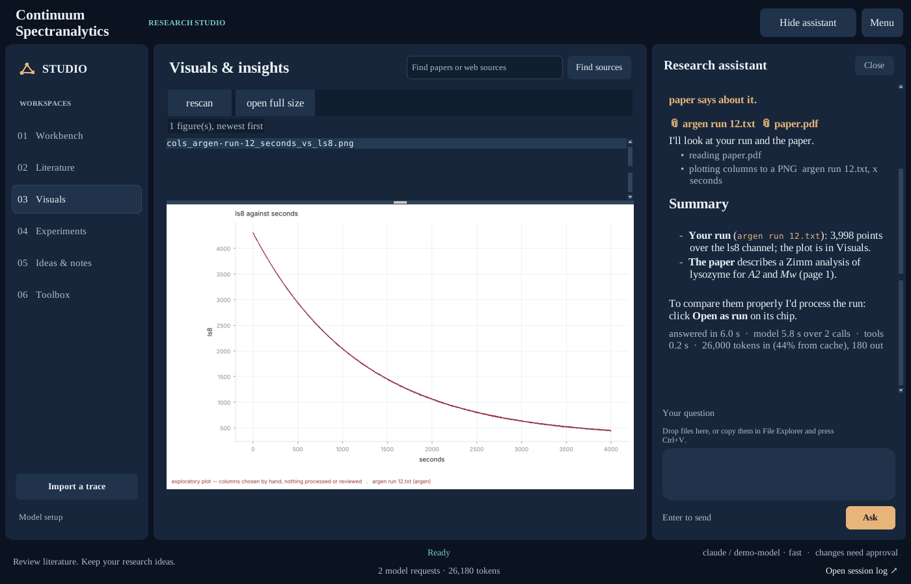

# Demo guide

A ten-minute walk through Continuum Spectranalytics: files in, a plot and a
cited answer out, with the timing shown under every answer.

## Before the demo (do this the day before)

1. **Use the fast-start build.** From the latest
   [Windows build](https://github.com/cognitogramma/lab_agent/actions/workflows/windows-build.yml)
   run, download **Continuum-Spectranalytics-windows-fast-start**, unzip it
   somewhere permanent (for example Documents), and start
   `Continuum Spectranalytics.exe` inside the folder. Measured on a Windows
   build machine, three launches each:

   | Version | Launch 1 | Launch 2 | Launch 3 |
   | --- | --- | --- | --- |
   | single `.exe` (120 MB) | 6.7 s | 16.3 s | 33.1 s |
   | fast-start folder | 1.6 s | 1.6 s | 1.6 s |

   The single `.exe` unpacks itself into Temp on every launch, and antivirus
   scans what it unpacks, so it gets slower, not faster. Keep the folder
   together: the `.exe` needs the `_internal` folder beside it.
2. **Connect a model.** Research assistant > **Model settings**: pick the
   provider, a model and **Speed: Fast**, paste the key, tick *save*, and
   select **Use this model**. With OpenAI, use **gpt-5.5** on **Fast**.

   Measured with a real key on the same question (attach a run and a paper,
   plot ls8, summarise the paper):

   | Model | Speed | Answer time |
   | --- | --- | --- |
   | gpt-5.5 | Fast | 4.9 s |
   | gpt-4.1 | (no setting) | 4.4 s |
   | gpt-5 | Fast | 6.0-7.1 s |
   | gpt-5 | default thinking | 14.7 s (the old behaviour) |
   | gpt-5-mini | Fast | 10-13 s (takes more steps) |

   A picture question (describe an attached plot) took 2.7 s on gpt-5.5 Fast.
3. **Allow your Desktop.** Session > **File access...**: tick Desktop for
   *read files* and *save copies here*.
4. **Put the demo files on the Desktop:** one ARGEN export, one PDF paper, one
   picture of a plot, and a Word protocol.
5. **Do one full rehearsal** with the real key, so the provider's cache is warm
   and you have seen the timings on that machine and network.

## The script

| Step | What you do | What the audience sees |
| --- | --- | --- |
| 1 | Drag the ARGEN export and the PDF onto the window. | Two chips appear, each saying what the file is; the ARGEN one offers **Open as run**. No model call yet. |
| 2 | Ask: *"Plot ls8 from my run and tell me what the paper says about it."* | The answer streams in; the status line shows each step ("Reading paper.pdf… 3 s"); the plot appears in Visuals. |
| 3 | Point at the line under the answer. | *answered in N s · model N s over N calls · tools N s · tokens (N% from cache)*. |
| 4 | Copy a plot image in File Explorer, press **Ctrl+V**, ask *"What does this figure show?"* | The model reads the picture itself. |
| 5 | Ask: *"Copy that plot to my Desktop and open it."* | Two approval prompts, then the figure opens in the image viewer. |
| 6 | Drop the Word protocol and ask *"Which filtration step does this protocol use?"* | Text and tables are read in order. |
| 7 | Type `/speed`. | The round-by-round table: where every second went. |

## If something is slow

- Type `/speed` after the slow answer. If **model** time dominates, choose a
  smaller model or Speed: Fast in Model settings. If it took **many calls**,
  attach the file instead of describing where it is, and ask more specifically.
- If **tools** time dominates, it is usually a large web page or a big data
  file; the table names the tool.
- If the window itself is slow to open, use the fast-start build (step 1).

## If something fails

- *"cannot attach that file"*: the message says why. Credential files and
  system folders are refused on purpose; old `.doc`/`.ppt` files need saving as
  `.docx`/`.pptx`.
- *"File access unavailable"*: tick the folder in Session > File access.
- A red banner about the provider: the key, the model name, or the account's
  credit. Model settings fixes all three without restarting.
- The session log (bottom right) has every request, timing and error.
